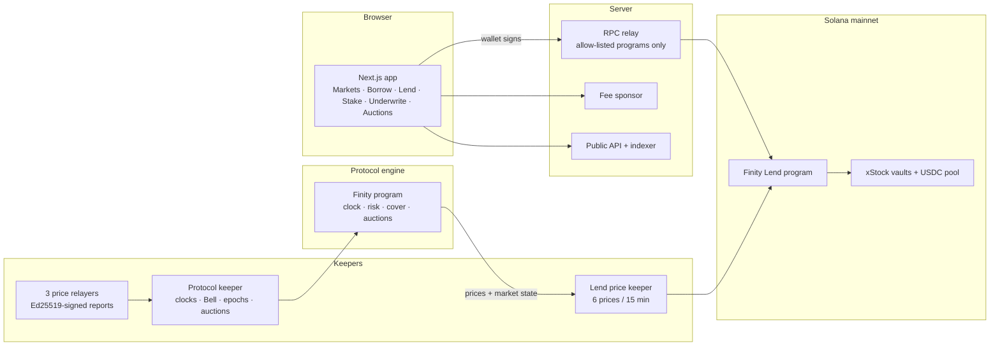

# Finity Finance

**Borrow on stocks, keep your weekend.** Finity is a lending protocol on Solana for tokenized stocks whose rules follow
each stock's real market clock, so a loan is never liquidated on a price the exchange never printed.

[](https://explorer.solana.com/address/He1CGvMi3EbBPiWJ4jdqgQhF5fauqSGq8nFHbo1DjQmL)
[](solana/lend/)
[](#8-addresses--revenue)
[](docs/litepaper/finity-litepaper.pdf)
[](LICENSE)


> **Live app: [srv2163833.hstgr.cloud](https://srv2163833.hstgr.cloud)** · [Stake](https://srv2163833.hstgr.cloud/stake) · [Public API](https://srv2163833.hstgr.cloud/v1/health)
>
> **Live on Solana mainnet:** borrow USDC against xStocks (AAPLx, AMZNx, GOOGLx, MSFTx, NVDAx, TSLAx).
> Program [`He1CGvMi3EbBPiWJ4jdqgQhF5fauqSGq8nFHbo1DjQmL`](https://explorer.solana.com/address/He1CGvMi3EbBPiWJ4jdqgQhF5fauqSGq8nFHbo1DjQmL)

---

## 1. What this is and who it's for

Finity Finance lets you borrow USDC against tokenized stocks on Solana, under rules that know when the stock market is
open, closing or closed. It is for:

- **Holders of tokenized stocks** who want liquidity without selling their AAPLx or NVDAx, and without being liquidated
  on a thin Sunday-night price.
- **Lenders** who want to earn on USDC with collateral they understand, protected by a risk model built for market closures.
- **Underwriters** who want to be paid for taking the reopen gap risk that lenders don't want.

## 2. Story & inspiration

We watched tokenized stocks arrive on Solana and saw the same thing happen again and again: a stock token trades all
weekend, the lending markets mark it every second, and a quiet Saturday price moves a few percent on no news. Loans get
liquidated on a price the Nasdaq never saw, and on Monday the stock opens exactly where it closed.

Crypto lending was designed for assets that never sleep. Stocks sleep for 80% of the week. We built Finity so that the
loan follows the stock's own schedule: mark it to a live price while the market trades, make it safe before the close,
and never liquidate it while the market is shut.

## 3. Problem

A US stock's regular session is 6.5 hours a day, 5 days a week: **32.5 of the week's 168 hours, about 19%**. For the
other 81% the token keeps trading on-chain while the price that gives it value is frozen. Lending protocols built for
crypto assets face a choice with no good answer:

| Approach | What goes wrong |
|---|---|
| Mark the weekend token price | Borrowers are liquidated on moves the reopen erases; liquidators farm thin weekend books |
| Ignore the weekend | Lenders silently carry the Friday-to-Monday gap; one earnings or fraud gap creates bad debt |
| Use a very low LTV all the time | Capital-inefficient for the 19% of the week when a live price exists |

The real risk is the **gap** at the reopen, and its size depends on the stock and the length of the closure.
Nobody prices it.

```math
G = \frac{P_{\mathrm{open}}}{P_{\mathrm{close}}} - 1
```

## 4. Solution

Finity makes the market clock a first-class part of every loan:

1. **The Asset Clock** tracks each stock's exchange calendar on-chain: sessions, early closes, holidays, halts and
   corporate actions.
2. **The Bell** opens 2 hours before every close. From then on, new borrowing is capped at a **closure-safe LTV**, the
   LTV that survives 99.9% of that stock's historical gaps for that kind of closure.
3. **Gap Cover** lets a borrower keep a higher LTV through the closure by paying a premium priced from the same gap
   history. An **Underwriter Pool** sells the cover and absorbs the first loss.
4. **No liquidations while the market is closed.** Repaying and adding collateral always work; the loan is marked again
   from the first real price after the reopen, and liquidations clear in **uniform-price batch auctions**, not a bot race.

## 5. How it works

### The loan follows the market clock

| Phase | When | Borrowing limit | Liquidation |
|---|---|---|---|
| **Open** | Regular session, until 2 h before the close | Max LTV | At a live price, when the health factor falls below 1 |
| **Bell window** | The last 2 h before the close | Closure-safe LTV, on debt projected to the reopen | At a live price |
| **Closed** | Overnight, weekend, holiday or halt | Closure-safe LTV | **Never** |
| **Reopen** | The first prices after the reopen | New debt paused until prices settle | Sealed-bid batch auction |

### Closure-safe LTV

For each stock and closure type, Finity stores a calibrated set of historical gaps $z_i$, in units of the stock's
volatility $\sigma$ and pooled across a peer group since 2016. Each gap maps to the share of collateral that survives
the reopen, after a dividend drop $\delta$ and a 3% liquidation haircut $\kappa$:

```math
g(z) = \max\left(0,\; 1 + \sigma z - \delta\right)\left(1 - \kappa\right)
```

The limit is the gap factor at the 1-in-1,000 scenario, capped at the market's maximum:

```math
\mathrm{LTV}_{\mathrm{safe}} = \min\left( g\left(z_{(k)}\right),\; \mathrm{LTV}_{\max} \right), \qquad k = \lceil \alpha n \rceil, \quad \alpha = 0.001
```

For AAPL over a weekend the gap factor is 89.5%, so the 75% cap binds.

### Projected debt

Interest keeps accruing while the market is closed, so the limit is measured on the debt as it will stand at the
reopen, after a closure of $d$ days:

```math
D_{\mathrm{proj}} = D \left( 1 + r \, \frac{d}{365} \right)
```

### Gap Cover premium

Each scenario's loss to the lender is the part of the projected debt the surviving collateral does not cover. The
premium charges the expected loss with a loading, plus the cost of capital held against the tail for the length of
the closure, and rises with the pool's utilization $u'$ after the sale:

```math
L_i = \max\left(0,\; D_{\mathrm{proj}} - V \, g(z_i)\right)
```

```math
\pi = \max\left( \pi_{\min},\; \left(1 + \eta \, u'^2\right) \left[ (1 + \theta) \, \mathrm{EL} + c \, \tau \, \mathrm{ES}_{\beta} \right] \right)
```

| Parameter | Meaning | Value |
|---|---|---|
| $\beta$ | Expected-shortfall level | 97.5% |
| $\theta$ | Loading on expected loss | 100% |
| $c$ | Annual cost of capital | 15% |
| $\eta$ | Utilization surcharge | 4 |
| $\pi_{\min}$ | Minimum premium | 0.50 USDC |

**Example.** A \$9,000 AAPL loan at 90% LTV, far above the 75% limit, costs about **\$0.55** to carry through a
weekend: only 3 of 3,000 historical scenarios lose money.

### Loss waterfall

A reopen shortfall is paid by the **Underwriter Pool** first, then the **protocol reserve**, and only then by
**senior lenders**.

All of the maths, with worked examples on real calibrated data, is in the
[litepaper](docs/litepaper/finity-litepaper.pdf).

## 6. Target users

| User | Why Finity |
|---|---|
| Long-term holders of tokenized stocks | Unlock USDC without selling, and without weekend liquidation risk |
| Active traders | Leverage on xStocks with limits that follow market hours |
| USDC lenders | Yield from borrowers of blue-chip collateral, with first-loss capital in front of them |
| Underwriters and market makers | Get paid for gap risk with premiums priced from history |
| Treasuries and DAOs holding stock tokens | Borrow against them as working capital |

## 7. Features

- **Mainnet lending against xStocks**: six markets (AAPLx, AMZNx, GOOGLx, MSFTx, NVDAx, TSLAx), one USDC pool, 55% max
  LTV, borrow and repay in one transaction each; paying a loan off returns all its collateral.
- **Token-2022 native**: xStocks with their permanent-delegate, pause, scaled-UI and transfer-hook extensions are handled
  with `TransferChecked`, alongside classic SPL USDC in the same instruction.
- **A 9,384-byte program**: the whole mainnet lending program, written in Pinocchio, deployed for about 0.064 SOL.
- **Price keeper**: posts all six prices in one transaction every 15 minutes while US markets are open; a price older than
  20 minutes pauses new borrowing automatically.
- **The full protocol engine**: Asset Clock with NYSE and US-bank calendars, the Bell, closure-safe LTV from calibrated
  scenario sets, Gap Cover and Underwriter Pools priced on 256 joint stress scenarios, a Senior Vault with a FIFO redeem
  queue, uniform-price batch auctions (intraday, extended hours, sealed-bid reopen, pre-close), 2-of-3 Ed25519-signed
  oracle reports, and a guardian with pause powers. It runs live with test tokens today, ahead of its mainnet rollout.
- **\$FINO staking**: fixed-term locks (7 to 365 days) with fixed rewards paid at unlock, at [`/stake`](apps/web/app/stake/).
- **Alerts**: the Bell, auction results, epoch settlements and withdrawals, by inbox (Sign-In With Solana), browser push,
  email or Telegram.
- **Public API**: read-only JSON for markets, pools, auctions, positions and history, with OpenAPI and Prometheus metrics.
- **Fee sponsoring**: the app covers network fees on the protocol pages, so users only sign.

## 8. Addresses & revenue

**Solana mainnet**

| What | Address |
|---|---|
| Finity Lend program | [`He1CGvMi3EbBPiWJ4jdqgQhF5fauqSGq8nFHbo1DjQmL`](https://explorer.solana.com/address/He1CGvMi3EbBPiWJ4jdqgQhF5fauqSGq8nFHbo1DjQmL) |
| Markets account | [`7wiQL1qrKVJumuYijeCMva4T2864xNsUUk3XgsM1cKHK`](https://explorer.solana.com/address/7wiQL1qrKVJumuYijeCMva4T2864xNsUUk3XgsM1cKHK) |
| Loan token: USDC | [`EPjFWdd5AufqSSqeM2qN1xzybapC8G4wEGGkZwyTDt1v`](https://explorer.solana.com/address/EPjFWdd5AufqSSqeM2qN1xzybapC8G4wEGGkZwyTDt1v) |
| AAPLx | [`XsbEhLAtcf6HdfpFZ5xEMdqW8nfAvcsP5bdudRLJzJp`](https://explorer.solana.com/address/XsbEhLAtcf6HdfpFZ5xEMdqW8nfAvcsP5bdudRLJzJp) |
| AMZNx | [`Xs3eBt7uRfJX8QUs4suhyU8p2M6DoUDrJyWBa8LLZsg`](https://explorer.solana.com/address/Xs3eBt7uRfJX8QUs4suhyU8p2M6DoUDrJyWBa8LLZsg) |
| GOOGLx | [`XsCPL9dNWBMvFtTmwcCA5v3xWPSMEBCszbQdiLLq6aN`](https://explorer.solana.com/address/XsCPL9dNWBMvFtTmwcCA5v3xWPSMEBCszbQdiLLq6aN) |
| MSFTx | [`XspzcW1PRtgf6Wj92HCiZdjzKCyFekVD8P5Ueh3dRMX`](https://explorer.solana.com/address/XspzcW1PRtgf6Wj92HCiZdjzKCyFekVD8P5Ueh3dRMX) |
| NVDAx | [`Xsc9qvGR1efVDFGLrVsmkzv3qi45LTBjeUKSPmx9qEh`](https://explorer.solana.com/address/Xsc9qvGR1efVDFGLrVsmkzv3qi45LTBjeUKSPmx9qEh) |
| TSLAx | [`XsDoVfqeBukxuZHWhdvWHBhgEHjGNst4MLodqsJHzoB`](https://explorer.solana.com/address/XsDoVfqeBukxuZHWhdvWHBhgEHjGNst4MLodqsJHzoB) |

The full address book is [`solana/client/lend.json`](solana/client/lend.json).

**Revenue.** Finity earns from the spread between what borrowers pay and what lenders receive. Every dollar of
interest is split **80% to senior lenders, 10% to the Underwriter Pool and 10% to the protocol reserve**, and Gap Cover
premiums go to the underwriters who carry the risk. The mainnet launch runs at zero interest to bring in the first
borrowers; protocol revenue switches on with interest and Gap Cover on mainnet (see the roadmap).

## 9. Sponsor & partner integrations

Finity is built on and integrates with:

| Integration | How Finity uses it |
|---|---|
| **Solana** | Every program, account and transaction |
| **xStocks** | The tokenized stocks accepted as collateral on mainnet |
| **USDC** | The loan token on mainnet |
| **Token-2022 (Token Extensions)** | Native handling of xStocks' extensions |
| **Phantom, Solflare, Backpack** | Wallets, through the Wallet Standard |
| **Squads** | Multisig handover of the admin role and upgrade authority |
| **QuickNode** | Private RPC behind the app's server-side proxy |
| **Alpaca** | Historical market data for the gap calibration |
| **Yahoo Finance** | Live quotes read by the price relayers |

## 10. Tech stack

| Layer | Technology |
|---|---|
| Mainnet program | Rust, **Pinocchio 0.12** (no framework, `no_std`, lazy entrypoint), Token-2022 + SPL Token CPI |
| Protocol engine | Rust, **Anchor 1.1**, fixed-point (18-decimal) risk maths, a reference crate for differential tests |
| Tests | **LiteSVM** (in-process Solana VM), real mainnet mint fixtures, property tests against `risk-core` |
| Client | TypeScript `@finity/solana`: instruction builders, decoders, PDAs and exact ports of the on-chain maths |
| Web | **Next.js 16**, React, TanStack Query, Solana wallet-adapter, Sign-In With Solana |
| Services | Node 24: relayers, keeper, Lend price keeper, indexer (SQLite), public API, notifier (web push, email, Telegram) |
| Ops | systemd services, nginx-ready proxy settings, pnpm + Turborepo monorepo |

## 11. Architecture



- **Wallets only sign.** The app sends every transaction through its own relay, which forwards only Finity
  transactions to a private RPC whose key never leaves the server.
- **The mainnet program trusts nothing it can check.** Vaults are bound to the markets account, positions to their owner,
  prices to a 20-minute freshness bound; duplicate accounts are rejected at the entrypoint.
- **Inputs fail closed.** If the clock, the prices or the calendar disagree, a market is treated as closed.

## 12. Competitors

| | Finity | General Solana lenders | Tokenized-stock venues |
|---|---|---|---|
| Collateral | Tokenized stocks, built for them | Crypto first; stocks listed like any other token | Trading, not lending |
| Weekend price | Never liquidates on it | Marked continuously | n/a |
| Closure risk | Priced per stock and closure length | Covered by one low LTV, or not at all | n/a |
| Gap insurance | Gap Cover + Underwriter Pool | None | None |
| Liquidations | Uniform-price batch auctions | First-come bot race | n/a |

We respect what Kamino, marginfi, Jupiter Lend and Save built for crypto collateral, and what Ondo Global Markets and
xStocks did to bring stocks on-chain. Finity is the missing piece between them: a lender that understands market hours.

## 13. Go to market

1. **xStocks holders first.** They already hold the collateral and want USDC without selling. We meet them where they
   trade: Solana DeFi communities, xStocks and wallet partners.
2. **Seed the pool with aligned capital**, grow it with yield from blue-chip borrowers, then open the Senior Vault to all
   lenders.
3. **Underwriters as a second market.** Market makers and funds that understand equity gaps get a native way to sell
   that risk.
4. **Integrations**: wallets, portfolio apps and aggregators that show "borrow against your stocks" next to a holder's
   balance.
5. **\$FINO** aligns long-term users: staking for fee discounts and rewards.

## 14. Business model

| Revenue line | Mechanism | Status |
|---|---|---|
| Interest spread | 10% of all borrow interest to the protocol reserve, 10% to underwriters, 80% to lenders | Built; on mainnet with interest |
| Gap Cover | Premiums priced per closure, paid to the Underwriter Pool | Built; mainnet next |
| Protocol share of premiums | A cut of Gap Cover premiums to the reserve | Planned |
| Liquidation auctions | A fee on value recovered in batch auctions | Planned |
| \$FINO fee discounts | Stakers pay lower loan fees, driving token demand | At token launch |
| Integrations | Revenue share with wallets and apps that route borrowers | Planned |

The reserve is first-loss capital after the Underwriter Pool, so revenue makes lenders safer as the protocol grows.

## 15. Roadmap

| Stage | What ships |
|---|---|
| ✅ **Live** | Finity Lend on mainnet: six xStock markets, USDC pool, 55% LTV, price keeper, Stake preview, litepaper |
| ✅ **Built** | The full protocol engine: Asset Clock, Bell, closure-safe LTV, Gap Cover, Underwriter Pools, Senior Vault, batch auctions, 2-of-3 oracle, guardian, alerts, API |
| **Next** | Interest and liquidation on mainnet; scenario-based closure-safe LTV per stock on mainnet |
| **Then** | Gap Cover, Underwriter Pools and the Senior Vault on mainnet; external audit; Squads multisig |
| **Token** | \$FINO launch, staking, fee discounts |
| **Later** | More stocks and venues, multi-source oracle, integrations with wallets and aggregators |

## 16. Team

Built by **[RyukendoLabs](https://github.com/ryukendolabs)**.

## 17. Run locally

Prerequisites (pinned in `.tool-versions`): Rust 1.95, Solana CLI 3.1, Anchor 1.1, Node 24, pnpm 10.

```sh
pnpm install
infra/local/up.sh        # builds the web app and starts every service as systemd user services
# web:  http://localhost:3000        stake: http://localhost:3000/stake
# API:  http://127.0.0.1:8787/v1/health
# logs: journalctl --user -fu finity-web      stop: infra/local/down.sh
```

Web app only: `cd apps/web && cp .env.example .env.local && pnpm dev`.

**Deploy to a server.** The live app runs on one Ubuntu VPS: a standalone Next.js server and one bundled file per
backend service (~86 MB in all), behind nginx with HTTPS, as hardened systemd services.

```sh
infra/hostinger/deploy.sh --setup --keys   # first time: Node, nginx, HTTPS, firewall, keys, services
infra/hostinger/deploy.sh                  # every update: build here, ship, restart (about a minute)
```

**Configuration.** Private settings live in `~/.config/finity/env` (mode 600), read by every service; keys sit next to
it and never enter the repo.

| Variable | Used for |
|---|---|
| `LEND_RPC_URL` | Private mainnet RPC for Finity Lend (the browser reaches it only through `/api/rpc/mainnet`) |
| `SOLANA_RPC_URL` | Private RPC for the protocol engine (the browser reaches it only through `/api/rpc`) |
| `LEND_LENDER` | The lender's wallet: the Lend page shows it the Supply action; never sent to the browser |
| `GAS_SPONSOR_KEY` | Fee sponsor for the protocol pages (server only) |
| `TRUST_PROXY_HEADERS` | `1` behind nginx, so rate limits count per client |
| `SMTP_URL`, `SMTP_FROM`, `TELEGRAM_BOT_TOKEN` | Email and Telegram alerts (off when unset) |

**Protocol engine from scratch** (idempotent loaders):

```sh
cd solana
anchor build
pnpm seed && pnpm load-risk && pnpm load-pool && pnpm load-oracle
RELAYER_INDEX=1 pnpm relayer & pnpm bot & pnpm indexer & pnpm api
```

**Finity Lend** (see [`docs/mainnet.md`](docs/mainnet.md)):

```sh
solana/lend/deploy.sh mainnet          # builds 3 variants, runs the tests, prints the exact cost, asks first
cd solana && pnpm lend seed --cluster mainnet && pnpm lend status --cluster mainnet
```

## 18. Verify / tests

```sh
cd solana && cargo test                 # 89 tests: protocol engine unit + integration, risk-core differential
cd solana/lend && cargo build-sbf && cargo test   # Finity Lend: end-to-end against the real AAPLx mint
cd solana && pnpm typecheck && (cd ../apps/web && npx tsc --noEmit)
cd solana && pnpm lend status --cluster mainnet  # the live markets, prices and pool, read from mainnet
```

- Every risk formula is tested bit for bit against the reference crate in
  [`solana/reference/risk-core`](solana/reference/risk-core/).
- Finity Lend's tests run the compiled program in LiteSVM with a copy of the **real mainnet AAPLx mint** (Token-2022,
  permanent delegate, pause and transfer-hook extensions): borrow, repay, over-limit refusal, stale-price gating, wrong
  accounts, teardown, liquidation.
- Anyone can verify the deployment: the program, the markets account and every vault are on the explorer (section 8).

## 19. Repo layout

| Path | What it is |
| --- | --- |
| [`solana/lend`](solana/lend/) | **Finity Lend**: the mainnet program (Pinocchio), its LiteSVM tests and `deploy.sh` |
| [`solana/programs/finity`](solana/programs/finity/) | The protocol engine (Anchor) and its integration tests |
| [`solana/reference/risk-core`](solana/reference/risk-core/) | Reference fixed-point risk maths for differential tests |
| [`solana/data/calibration`](solana/data/calibration/) | Calendars, scenario sets, joint stress columns and σ tables |
| [`solana/client`](solana/client/) | TypeScript client `@finity/solana`, including `lend.ts` and the address books |
| [`solana/scripts`](solana/scripts/) | Loaders, keepers, relayers, indexer, API, notifier, `pnpm lend` operations |
| [`solana/notify`](solana/notify/) | Alert inbox and delivery by push, email and Telegram |
| [`apps/web`](apps/web/) | The web app, the stake page, the RPC relay, fee sponsor and Sign-In With Solana |
| [`apps/web/public/site`](apps/web/public/site/) | The landing page |
| [`infra/local`](infra/local/) | systemd services that host every service on one machine |
| [`infra/hostinger`](infra/hostinger/) | Production deploy: server setup, nginx, hardened systemd units, `deploy.sh` |
| [`docs`](docs/) | [Litepaper](docs/litepaper/finity-litepaper.pdf), [mainnet guide](docs/mainnet.md) |

## 20. Security notes

- **Keys never touch the repo.** They live in `~/.config/finity` (mode 600); the relayers hold no SOL and send nothing.
- **The RPC relay is allow-listed.** It forwards only transactions that call Finity Lend or move tokens into its pool,
  only from this site's pages, with per-client rate limits; program scans need filters.
- **The lender's address stays on the server.** The app only learns whether a connected wallet is the lender.
- **Mainnet program safety.** Duplicate accounts rejected at the entrypoint; vaults checked against the markets account
  on every transfer; integer LTV maths without division or overflow; borrowing needs a price under 20 minutes old;
  repaying never needs one. A smaller teardown build returns every user's collateral and the pool to the lender.
- **Known risks we are open about.** Mainnet Lend has no liquidation yet (the 55% limit gives a 45% buffer, and the pool
  is kept small until liquidation ships); prices come from our keeper; xStocks' issuer holds a permanent delegate and
  a pause switch. No external audit yet. See the [litepaper](docs/litepaper/finity-litepaper.pdf), section 9.
- **Report a vulnerability** privately through GitHub Security Advisories on this repository.

## 21. License

MIT. See [LICENSE](LICENSE).

## 22. Token flywheel

Published at the \$FINO launch.

## 23. Token details

Published at the \$FINO launch.
